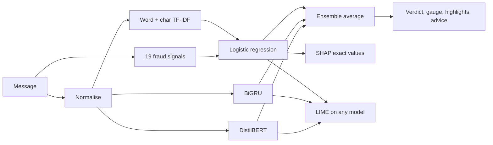

# ScamShield: Financial Scam & Phishing SMS / Email Detector (NLP-19)

Explainable NLP system that classifies SMS, WhatsApp messages and emails as scam or genuine, shows the
**fraud probability**, **highlights the suspicious phrases**, and explains the decision with **LIME and SHAP**.

## Project brief → implementation

| Requirement from the brief | Where it is implemented |
|---|---|
| Detect fraudulent banking alerts, UPI scams and phishing emails with text classification | `train.py`, `features.py` (7 scam families incl. UPI collect, KYC, digital arrest, Hinglish) |
| **TF-IDF + feature engineering** | `features.py`: word and character TF-IDF + 19 engineered signals |
| Urgency and URL pattern indicators | `features.py`: urgency terms, shortened / look-alike / IP / bad-TLD links, OTP-PIN requests, upfront fees, UPI IDs |
| **BiGRU classification** | `deep.py` (`make_bigru`, `train_bigru`), trained with `train_deep.py --model bigru` |
| **DistilBERT classification (Hugging Face)** | `deep.py` (`train_distilbert`, `BertScorer`), trained with `train_deep.py --model distilbert` |
| **Explainability: LIME** | `explain.lime_explain`, works for every model, button in the app and `POST /api/explain` |
| **Explainability: SHAP** | `explain.LinearShap` (exact SHAP values), global importance plots, SHAP beeswarm when `shap` is installed |
| **UCI SMS Spam dataset** | `download_data.py` (5,574 real SMS) |
| **Phishing email dataset** | `download_data.py --emails` (SpamAssassin public corpus) + drop-in support for the Kaggle *Phishing Email Dataset* CSV |
| Python, scikit-learn, Hugging Face, LIME | `requirements.txt`, `requirements-deep.txt` |
| **Real-time message checker with fraud probability and highlighted suspicious phrases** | `app.py` + `static/`: scores as you type, word highlighting, risk gauge |
| Model comparison and evaluation | `train.py` / `train_deep.py` → `models/model_card.json`, ROC/PR, calibration, confusion matrix |

## Run it

**Quick start (logistic-regression model, works immediately)**
```powershell
pip install -r requirements.txt
.\run.bat
```
Open <http://127.0.0.1:5000>.

**Full pipeline (all models, real data, LIME)** - one command on Windows:
```powershell
.\setup_deep.bat
```
It performs these steps (you can also run them one by one):
```powershell
pip install -r requirements-deep.txt          # torch, transformers, lime (large download)
python -m scamshield.download_data --emails   # UCI SMS + SpamAssassin emails -> data/raw/
python -m scamshield.train                    # TF-IDF + features + Logistic Regression, SHAP, plots
python -m scamshield.train_deep --model bigru # BiGRU: a few minutes on CPU
python -m scamshield.train_deep --model distilbert --max-samples 4000   # roughly 10-25 min on CPU
.\run.bat
```
Optional: `pip install -r requirements-optional.txt` adds the SHAP beeswarm plot (SHAP values themselves do not need it).
For modern phishing emails, also download the Kaggle *Phishing Email Dataset* CSV and put it in `data/raw/` (the columns `Email Text` and `Email Type` are recognised).

**Troubleshooting**
* SSL / certificate errors behind a proxy or antivirus: `pip install --trusted-host pypi.org --trusted-host files.pythonhosted.org pip-system-certs`, then retry. `download_data` accepts `--insecure`.
* DistilBERT too slow: lower `--max-samples` (for example 2000) or `--epochs 1`. On a GPU or Colab it takes minutes.
* The first DistilBERT run downloads about 260 MB from huggingface.co.

## Using the app

* **Scan message**: paste text; choose **Logistic Regression**, **BiGRU**, **DistilBERT** or **Ensemble** (average of all trained models). The *Model votes* panel shows what each model thinks. *Explain this verdict* gives **SHAP values** (which signals pushed the score, relative to an average message) and **LIME** (word weights for the chosen model).
* **Bulk scan**: upload a CSV with a `text` column (up to 500 rows) and export the results.
* **Model & accuracy**: comparison table, ROC / PR, calibration, confusion matrix, SHAP importance, status of every model.
* Highlighted words in the message always come from the fast logistic-regression model (log-odds occlusion), so they appear instantly.

## How it works



* **SHAP.** For a linear model the Shapley value of a feature is `coef * (x - mean)`, identical to `shap.LinearExplainer` (interventional). It is evaluated directly, so it is instant and exactly additive: base value + sum of SHAP values equals the model's log-odds (verified in the tests).
* **LIME.** Randomly removes words, queries the model, and fits a local linear surrogate. It is model-agnostic and is the way BiGRU and DistilBERT are explained.
* **Thresholds** for the logistic-regression verdicts are data-driven (cross-validation, never the test set). Deep models and the ensemble use fixed 0.35 / 0.65 cut-offs.
* **Honest evaluation.** Synthetic test data uses message templates never seen in training; real data uses a deterministic hash split; metrics are reported per source.

## Results

Numbers are in `models/model_card.json` and the *Model & accuracy* tab. Always quote the **per-source real-data** rows after training with `download_data`. The bundled model was trained on synthetic data only (F1 0.97 on held-out templates), which over-states real-world accuracy. A run on the real UCI SMS data scored F1 0.89 at the "scam" verdict with precision 1.00 and ROC-AUC 0.995.

## Verification status

* **Tested automatically (36 tests):** features, scoring, thresholds, email parsing, data loaders, the REST API, the SHAP maths (exact additivity), the LIME plumbing (with a stand-in), model selection, the ensemble and votes (with stand-in deep models), and the model-card merge.
* **Needs its first real run on your machine:** training and inference of BiGRU and DistilBERT, the real `lime` package, and the SHAP beeswarm. These need PyTorch / Transformers / LIME, which could not be installed while the code was written. The code paths are isolated: if a package is missing the app reports exactly what to install and everything else keeps working.

## API

| Method | Endpoint | Purpose |
|---|---|---|
| POST | `/api/check` | `{"text","model":"lr\|bigru\|distilbert\|ensemble"}` → score, verdict, scam family, votes, highlights, reasons, advice |
| POST | `/api/explain` | `{"text","method":"shap\|lime","model"}` → contributions |
| POST | `/api/batch` | CSV upload or `{"texts":[...]}`, optional `model` |
| POST | `/api/feedback` | append a correction to the retraining log (`python -m scamshield.train --feedback`) |
| GET | `/api/models`, `/api/model`, `/api/health` | model availability, model card, liveness |

## Layout

```
scamshield/
  config.py        paths, limits               data_gen.py       synthetic corpus (English + Hinglish)
  features.py      TF-IDF, 19 signals          download_data.py  UCI SMS + SpamAssassin emails
  datasets.py      loaders, splits             train.py          LR pipeline, comparison, SHAP plots, model card
  deep.py          BiGRU + DistilBERT          train_deep.py     deep training, evaluation, ensemble row
  explain.py       LIME + SHAP                 predict.py        model registry, ensemble, highlights
  app.py           Flask API                   static/           UI (light and dark themes)
tests/             36 tests                    setup_deep.bat/.sh, run.bat/.sh, Dockerfile
```

ScamShield gives a risk estimate, not proof. In India report fraud on **1930** or **cybercrime.gov.in**; forward spam SMS to **1909**.
